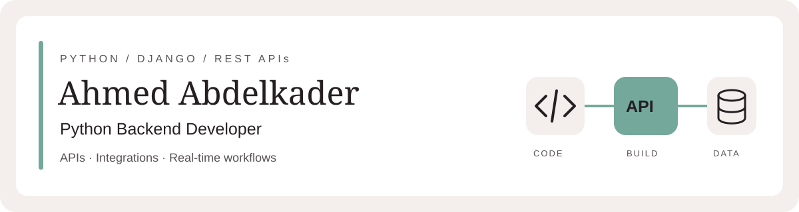

  

  
  

## 👋 About me

I build **Django applications, REST APIs, payment integrations, and real-time workflows**. My work includes backend security, database performance, and multi-tenant systems.

I'm looking for **Python/Django backend opportunities** in Egypt and remotely.

## 🛠️ Technology toolkit

  
  
  
  

  
  
  
  

**Also work with:** Django Channels · MySQL · SQLite · JWT · OAuth2 · role-based access control · DigitalOcean · Gunicorn · Daphne

## ⚡ Experience in practice

| Focus | What I've delivered |
| :--- | :--- |
| 🛡️ **Backend & security** | End-to-end backend development at **Niram**, including performance and security improvements. Contributed to a **32% improvement in website loading speed**. |
| 🔌 **APIs & performance** | Delivered **15+ REST APIs across 3 production products** at **Dracode Software House**. Reduced API response time by **40%** through query optimization. |
| 🤝 **Client work** | Occasional freelance projects alongside employed roles, including documented APIs, payment integrations, and backend improvements. |

## 📂 Explore my public code

### 🔌 Backend API projects

- **[MealsRater_API](https://github.com/Ahmed0Abd0El0Kader/MealsRater_API)**
- **[CienemaTicketsReservation_API](https://github.com/Ahmed0Abd0El0Kader/CienemaTicketsReservation_API)**

### 👁️ Computer vision

- **[Real-time video filtering with OpenCV](https://github.com/Ahmed0Abd0El0Kader/Real-Time-Video-Filtering-with-Webcam-using-OpenCV)**

## 🌱 Currently learning

**Odoo technical and functional development** through Odoo Ninja, currently at the beginner stage. My current job focus remains **Python/Django backend development**.

---

<b>Let's build reliable backend systems.</b> <a href="https://www.linkedin.com/in/ahmedabdel-kader">Connect with me on LinkedIn</a>

